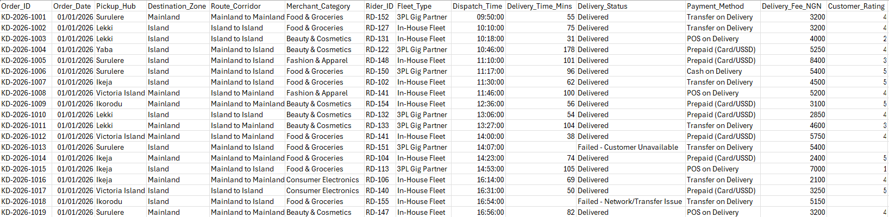
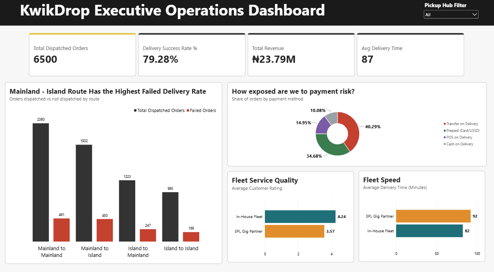

# KwikDrop Last-Mile Delivery Performance Report (January – June 2026)

## Executive Summary
KwikDrop dispatched 6,500 orders in H1 2026 and delivered 79.3% of them, earning ₦23.79m in delivery fees. One in five orders (1,347) was not delivered, leaving ₦6.38m in fees unearned.
Three issues stand out. Mainland to Island is the weakest route (23.3% failure, 128 min average). Transfer on Delivery, the most used payment method, fails 27.9% of the time. 3PL riders are slower and lower rated than in-house riders. Fixing the cross-bridge route, pushing prepayment and tightening 3PL standards would recover a large share of lost revenue and directly address merchant complaints.

## Business Context
KwikDrop is a Lagos last-mile delivery company serving e-commerce, social commerce and food merchants. Order volume grew quickly in 2026, but merchant churn rose 14%, with vendors citing unpredictable delivery times, failed deliveries and poor rider accountability. Operations reviews relied on raw Excel sheets, so problems surfaced only after complaints. Management needed a single dashboard to spot bottlenecks, compare fleets and measure payment risk.

## Objectives
- What are KwikDrop's headline delivery volume, success rate, revenue and delivery time?
- Which route corridors cause the most failures and delays?
- How does the 3PL fleet compare with the in-house fleet on speed and customer rating?
- How exposed is KwikDrop to pay-on-delivery risk?

## Data Overview
The data is KwikDrop's order log, exported as a CSV file. It covers 1 January to 30 June 2026 and contains 6,500 rows (one per order) across 14 columns. It spans 6 pickup hubs, 4 route corridors, 59 riders, 2 fleet types and 4 payment methods. Delivery time and customer rating are recorded only for delivered orders.

## Data Preview

## Key Findings
- 79.3% of orders were delivered; ₦6.38m in fees was lost on 1,347 undelivered orders.
- Mainland to Island has the highest failure rate (23.3%) and slowest deliveries (128 min), yet brings in the most revenue (₦9.69m, 41% of total).
- Evening dispatches on Mainland to Island fail 35.7% of the time.
- Transfer on Delivery fails 27.9% of the time, more than double prepaid (13.3%).
- 65.3% of orders are paid on delivery.
- In-house riders beat 3PL riders on speed (82 vs 92 min), rating (4.24 vs 3.57) and success rate (80.5% vs 77.8%).
- Deliveries over 100 minutes average 2.87 stars, against 4.48 for faster ones.

## Dashboard

## Link to Power BI Report
Click the link to access the full Power BI report: [Click here](https://app.powerbi.com/view?r=eyJrIjoiYWY2NmQ1MDEtYmZkZS00OTkzLTg4YTYtZWQ4OGVjNmEwMzkyIiwidCI6IjZjNzQ3Mzg1LTUyNTktNDcwMS05MTkzLTc5ZTkxNWNlYjA3ZSJ9)

## Data Cleaning and Transformation
All steps were done in Power Query.
- Loaded the CSV and renamed the query Deliveries.
- Set data types: Order_Date (Date), Dispatch_Time (Time), Delivery_Time_Mins, Delivery_Fee_NGN and Customer_Rating (Whole Number), all others (Text).
- Checked for duplicates: all 6,500 Order_IDs unique, no duplicate rows.
- Checked text columns for inconsistent casing, spelling and extra spaces: none found.
- Kept nulls in Delivery_Time_Mins and Customer_Rating for undelivered orders, rather than replacing them with 0, so averages are not distorted.

## Detailed Findings & Analysis
### Headline Performance
KwikDrop dispatched 6,500 orders, delivered 79.3% of them and earned ₦23,787,150 in fees. The average delivery took 86.7 minutes from dispatch to doorstep.
Monthly volume rose 60%, from 840 orders in January to 1,347 in June. Success rate dipped to its lowest in April (77.3%), the start of the rainy season.
The main reason orders failed was customer unavailable (551 orders), followed by network/transfer issues (349), returns (319) and merchant cancellations (128).

### Route Bottlenecks
- Mainland to Mainland: 2,360 orders, 19.5% failure, 56 min average, ₦5.22m revenue.
- Mainland to Island: 1,932 orders, 23.3% failure, 128 min average, ₦9.69m revenue.
- Island to Mainland: 1,223 orders, 20.2% failure, 115 min average, ₦6.29m revenue.
- Island to Island: 985 orders, 19.2% failure, 47 min average, ₦2.58m revenue.

Cross-bridge deliveries take more than twice as long as same-side ones. Mainland to Island is both the riskiest and most valuable route, so every failure there costs the most.

### Fleet Performance
In-house riders deliver in 82.4 minutes on average, against 92.1 minutes for 3PL riders. Customers rate in-house riders 4.24 out of 5, compared with 3.57 for 3PL riders. In-house riders also complete more orders (80.5% vs 77.8%).
Speed drives ratings: slow deliveries (over 100 min) average 2.87 stars. Friday afternoon dispatches average 104 minutes, against 85 at other times.

### Payment Risk
- Transfer on Delivery: 40.3% of orders, 27.9% failure rate.
- Prepaid (Card/USSD): 34.7% of orders, 13.3% failure rate.
- POS on Delivery: 15.0% of orders, 19.5% failure rate.
- Cash on Delivery: 10.1% of orders, 19.1% failure rate.

Network or transfer problems alone cause 11.3% of Transfer on Delivery orders to fail. Prepaid orders never fail for this reason.

### Hub Comparison
Hub success rates are close (77.6% Yaba to 80.9% Lekki). Surulere is the slowest hub at 95.5 minutes. Ikeja is the largest by volume (1,651 orders) and revenue (₦5.88m).

## Recommendations
- Fix Mainland to Island: add a confirm-before-dispatch call, avoid evening dispatches across the bridge, and consider an Island micro-hub for afternoon Mainland orders.
- Push prepayment: offer a small discount for prepaid orders, and require customers to confirm transfer readiness before the rider leaves.
- Hold 3PL partners to standards: set minimum speed and rating targets in contracts, and route high-value cross-bridge orders to in-house riders.
- Reduce failed attempts: send automated arrival alerts so customers are reachable, since unavailability is the top failure cause.
- Plan for peak friction: add rider capacity for Friday afternoons and the rainy season (April–June).
- Investigate Surulere delivery times.

## Tools Used
- Power Query: data loading and cleaning
- DAX: measures
- Power BI Desktop: modelling and visualisation

## Conclusion
KwikDrop is growing fast, but one in five orders fails, costing ₦6.38m in unearned fees and driving merchant churn. The causes are concentrated: the Mainland to Island route, Transfer on Delivery payments and slower 3PL riders. Acting on these three areas gives KwikDrop the clearest path to higher success rates, more revenue and happier merchants.

